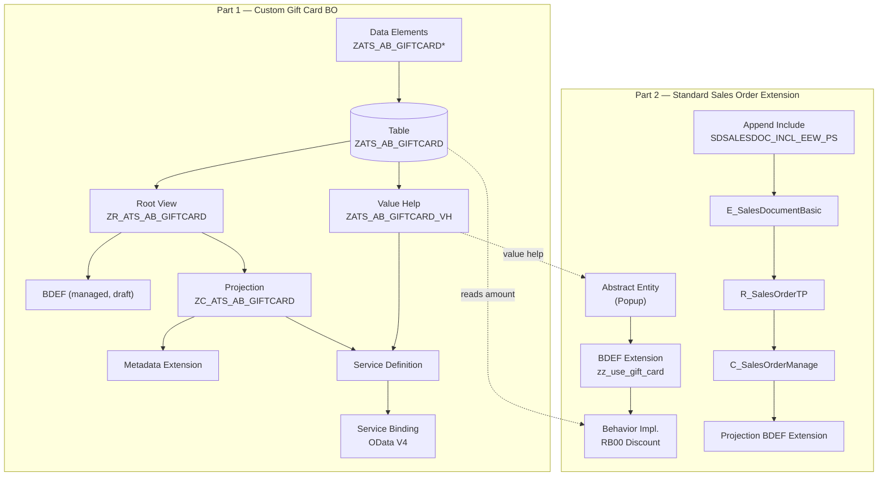
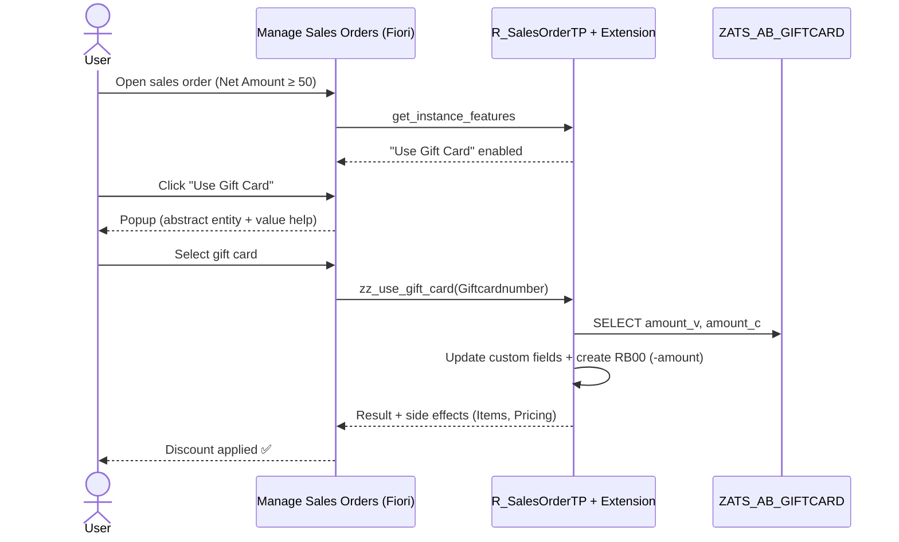

<div align="center">

# 🎁 Sales Order Gift Card Scenario — SAP S/4HANA

### Custom RAP Business Object + Extension of the Standard *Manage Sales Orders* Fiori App with Embedded Steampunk


</div>

---

## 📖 Overview

This repository contains the complete source code for an end-to-end **gift card scenario** in SAP S/4HANA, built in two parts:

1. **Part 1 — Gift Card Master App:** A custom managed RAP business object (with draft) exposed as a Fiori Elements List Report / Object Page to maintain gift cards and their values.
2. **Part 2 — Extending the Standard Sales Order App:** Using **Embedded Steampunk** (ABAP Cloud developer extensibility), we add custom gift card fields to the sales order, plus a **"Use Gift Card"** action that opens a popup, lets the user pick a gift card, and applies the gift card value as a **`RB00` discount pricing condition** at runtime.

> 💡 The action is only enabled when the sales order's **Total Net Amount ≥ 50** (dynamic feature control).

---

## 🏗️ Architecture



---

## 📦 Object Inventory

| # | Object | Type | Purpose |
|---|--------|------|---------|
| 1 | `ZATS_AB_GIFTCARDNUM` / `AMT` / `DESC` | Data Elements | Gift card number, amount, description |
| 2 | `ZATS_AB_GIFTCARD` | Database Table | Gift card master data |
| 3 | `ZR_ATS_AB_GIFTCARD` | Root View Entity | RAP BO interface layer |
| 4 | `ZR_ATS_AB_GIFTCARD` | Behavior Definition | Managed + draft behavior |
| 5 | `ZC_ATS_AB_GIFTCARD` | Projection View | Consumption layer |
| 6 | `ZC_ATS_AB_GIFTCARD` | Projection BDEF | Exposed operations |
| 7 | `ZBP_R_ATS_AB_GIFTCARD` | ABAP Class | Behavior implementation (generated) |
| 8 | `ZATS_AB_GIFTCARD_VH` | View Entity | Value help for gift cards |
| 9 | `ZC_ATS_AB_GIFTCARD` | Metadata Extension | Fiori UI annotations |
| 10 | `ZC_ATS_AB_GIFTCARD_SD` | Service Definition | Exposed entities |
| 11 | — | Service Binding | OData V4 UI |
| 12 | `ZATS_AB_APP_GIFTCARD_SDH` | Append Structure | Custom fields on sales document |
| 13 | `E_SalesDocumentBasic` / `R_SalesOrderTP` / `C_SalesOrderManage` | CDS Extensions | Field propagation through the VDM stack |
| 14 | `ZATS_AB_ASSIGNGIFTCARDTOSO` | Abstract Entity | Action parameter popup |
| 15 | `R_SalesOrderTP` | BDEF Extension | Custom action `zz_use_gift_card` |
| 16 | `ZBP_XE4_GIFTCARD_EXT` | ABAP Class | Action + feature control implementation |
| 17 | `C_SalesOrderManage` | Projection BDEF Extension | Expose action to the UI |

---

## ✅ Prerequisites

- SAP S/4HANA (Cloud Public Edition, or Private/On-Premise 2022+) with developer extensibility (Embedded Steampunk) enabled
- ABAP Development Tools (ADT) in Eclipse
- Released extension points for `R_SalesOrderTP` / `I_SalesOrderTP`
- Pricing condition type **`RB00`** available in the sales pricing procedure

---

# 🧩 Part 1 — Custom Gift Card Application

### Step 1: Create Data Elements

| Data Element | Data Type | Length |
|---|---|---|
| `ZATS_AB_GIFTCARDNUM` | `NUMC` | 10 |
| `ZATS_AB_GIFTCARDAMT` | `CURR` | 12,2 |
| `ZATS_AB_GIFTCARDDESC` | `CHAR` | 40 |

---

### Step 2: Database Table — Gift Card Master Data

```abap
@EndUserText.label : 'Master table to store cards and value'
@AbapCatalog.enhancement.category : #NOT_EXTENSIBLE
@AbapCatalog.tableCategory : #TRANSPARENT
@AbapCatalog.deliveryClass : #A
@AbapCatalog.dataMaintenance : #RESTRICTED
define table zats_ab_giftcard {

  key client         : abap.clnt not null;
  key sap_uuid       : sysuuid_x16 not null;
  giftcardnumber     : zats_ab_giftcardnum not null;
  sap_description    : zats_ab_giftcarddesc not null;
  @Semantics.amount.currencyCode : 'zats_ab_giftcard.amount_c'
  amount_v           : zats_ab_giftcardamt not null;
  amount_c           : abap.cuky;
  local_last_changed : abp_locinst_lastchange_tstmpl;
  last_changed       : abp_lastchange_tstmpl;

}
```

---

### Step 3: Define the RAP BO — Root View Entity

```abap
@AccessControl.authorizationCheck: #NOT_REQUIRED
@EndUserText.label: 'RAP BO for gift card (root)'
@Metadata.ignorePropagatedAnnotations: true
define root view entity ZR_ATS_AB_GIFTCARD as select from zats_ab_giftcard
{
    key sap_uuid as SapUuid,
    giftcardnumber as Giftcardnumber,
    sap_description as SapDescription,
    @Semantics.amount.currencyCode: 'AmountC'
    amount_v as AmountV,
    amount_c as AmountC,
    @Semantics.systemDateTime.localInstanceLastChangedAt: true
    local_last_changed as LocalLastChanged,
    @Semantics.systemDateTime.lastChangedAt: true
    last_changed as LastChanged
}
```

---

### Step 4: Behavior Definition — Managed with Draft

```abap
managed implementation in class zbp_r_ats_ab_giftcard unique;
strict ( 2 );
with draft;

define behavior for ZR_ATS_AB_GIFTCARD alias Giftcard
persistent table zats_ab_giftcard
draft table zats_ab_dgift
etag master LocalLastChanged
lock master
total etag LastChanged
authorization master ( instance )
{
  field (readonly) sapuuid, lastchanged, locallastchanged;
  field (numbering: managed) sapuuid;

  create ( authorization : global );
  update;
  delete;

  draft action Edit;
  draft action Activate;
  draft action Discard;
  draft action Resume;
  draft determine action Prepare;

  mapping for zats_ab_giftcard{
    SapUuid = sap_uuid;
    Giftcardnumber = giftcardnumber;
    SapDescription = sap_description;
    AmountV = amount_v;
    AmountC = amount_c;
    LocalLastChanged = local_last_changed;
    LastChanged = last_changed;
  }
}
```

> 📝 The draft table `ZATS_AB_DGIFT` can be generated directly from the BDEF using an ADT quick fix.

---

### Step 5: BO Projection Layer — Projection View

```abap
@AccessControl.authorizationCheck: #NOT_REQUIRED
@EndUserText.label: 'Projection entity for gift card'
@Metadata.ignorePropagatedAnnotations: false
@Metadata.allowExtensions: true
define root view entity ZC_ATS_AB_GIFTCARD as projection on ZR_ATS_AB_GIFTCARD
{
    key SapUuid,
    Giftcardnumber,
    SapDescription,
    AmountV,
    AmountC,
    LocalLastChanged,
    LastChanged
}
```

---

### Step 6: BO Projection Layer — Projection BDEF

```abap
projection;
strict ( 2 );
use draft;

define behavior for ZC_ATS_AB_GIFTCARD alias Giftcard
use etag
{
  use create;
  use update;
  use delete;

  use action Edit;
  use action Activate;
  use action Discard;
  use action Resume;
  use action Prepare;
}
```

---

### Step 7: Generate the Behavior Implementation Class

Use the **ADT Quick Fix** (`Ctrl + 1`) on the BDEF to generate the implementation class `ZBP_R_ATS_AB_GIFTCARD`, then **activate** all objects.

---

### Step 8: Value Help Entity

```abap
@AbapCatalog.viewEnhancementCategory: [#NONE]
@AccessControl.authorizationCheck: #NOT_REQUIRED
@EndUserText.label: 'Value help entity for gift cards'
@Metadata.ignorePropagatedAnnotations: true
@ObjectModel.dataCategory: #VALUE_HELP
@Consumption.valueHelpDefault.fetchValues: #AUTOMATICALLY_WHEN_DISPLAYED
@Search.searchable: true
@Consumption.ranked: true
@ObjectModel.representativeKey: 'Giftcardnumber'
define view entity ZATS_AB_GIFTCARD_VH as select from zats_ab_giftcard
{
    @UI.hidden: true
    key sap_uuid as SapUuid,
    @ObjectModel.text.element: [ 'SapDescription' ]
    giftcardnumber as Giftcardnumber,
    @Search:{
        defaultSearchElement: true,
        ranking: #HIGH,
        fuzzinessThreshold: 0.8
    }
    sap_description as SapDescription,
    @Semantics.amount.currencyCode: 'AmountC'
    amount_v as AmountV,
    amount_c as AmountC
}
```

---

### Step 9: Metadata Extension — Fiori UI Annotations

```abap
@Metadata.layer: #CUSTOMER
@UI.headerInfo:{
    typeName: 'Gift card',
    typeNamePlural: 'Gift Cards',
    title: { type: #STANDARD, value: 'Giftcardnumber' },
    description: { type: #STANDARD, value: 'SapDescription' }
}
@Search.searchable: true
annotate entity ZC_ATS_AB_GIFTCARD
    with 
{
    @UI.facet: [
        {  
            id: 'idGift',
            type: #IDENTIFICATION_REFERENCE,
            purpose: #STANDARD,
            position: 10,
            label: 'Gift card details'
        }
    ]
    @UI.hidden: true
    SapUuid;
    @Search.defaultSearchElement: true
    @UI.selectionField: [{ position: 10 }]
    @UI.lineItem: [{ position: 10 }]
    @UI.identification: [{ position: 10 }]
    @Consumption.valueHelpDefinition: [{ 
        entity.name: 'ZATS_AB_GIFTCARD_VH',
        entity.element: 'Giftcardnumber'
         }]
    Giftcardnumber;
    @Search.defaultSearchElement: true
    @UI.selectionField: [{ position: 20 }]
    @UI.lineItem: [{ position: 20 }]
    @UI.identification: [{ position: 20 }]    
    SapDescription;
    @Search.defaultSearchElement: true
    @UI.selectionField: [{ position: 30 }]
    @UI.lineItem: [{ position: 30 }]
    @UI.identification: [{ position: 30 }]    
    AmountV;
    @UI.selectionField: [{ position: 40 }]
    @UI.lineItem: [{ position: 40 }]
    @UI.identification: [{ position: 40 }]
    @Consumption.valueHelpDefinition: [{ 
        entity.name: 'I_CurrencyStdVH',
        entity.element: 'Currency'
         }]
    AmountC;
    @UI.lineItem: [{ position: 50 }]
    @UI.identification: [{ position: 50 }]
    LocalLastChanged;
    @UI.lineItem: [{ position: 60 }]
    LastChanged;
    
}
```

---

### Step 10: Service Definition

```abap
@EndUserText.label: 'Service definition for gift card'
define service ZC_ATS_AB_GIFTCARD_SD {
  expose ZC_ATS_AB_GIFTCARD  as Giftcard;
  expose ZATS_AB_GIFTCARD_VH as GiftCardHelp;
  expose I_CurrencyStdVH     as Currency;
}
```

---

### Step 11: Service Binding

Create a service binding on `ZC_ATS_AB_GIFTCARD_SD` with binding type **OData V4 – UI**, **publish** it, and use **Preview** on the `Giftcard` entity set to launch the Fiori Elements app.

---

# 🚀 Part 2 — Extending the Standard Fiori App (Embedded Steampunk)

Here we extend the standard **Manage Sales Orders** app so a user can apply a gift card to a sales order.

### Step 1: Append Include on `SDSALESDOC_INCL_EEW_PS`

```abap
@EndUserText.label : 'Append include for gift cards custom fields'
@AbapCatalog.enhancement.category : #NOT_EXTENSIBLE
extend type sdsalesdoc_incl_eew_ps with zats_ab_app_giftcard_sdh {

  @Semantics.amount.currencyCode : 'zats_ab_app_giftcard_sdh.zz_giftcardcurrency_sdh'
  zz_giftcardamount_sdh   : zats_ab_giftcardamt;
  zz_giftcardcurrency_sdh : abap.cuky;

}
```

---

### Step 2: Extend Extension Include View `E_SalesDocumentBasic` (VBAK)

```abap
extend view entity E_SalesDocumentBasic with
association [0..1] to I_Currency as _Currency on
$projection.zz_giftcardcurrency_sdh  = _Currency.Currency
 {
    @Semantics.amount.currencyCode: 'zz_giftcardcurrency_sdh'
    Persistence.zz_giftcardamount_sdh,
    @ObjectModel.foreignKey.association: '_Currency'
    Persistence.zz_giftcardcurrency_sdh,
    _Currency
}
```

---

### Step 3: Extend the Transactional View `R_SalesOrderTP`

```abap
extend view entity R_SalesOrderTP with {
    @Semantics.amount.currencyCode: 'zz_giftcardcurrency_sdh'
    _Extension.zz_giftcardamount_sdh,
    _Extension.zz_giftcardcurrency_sdh
}
```

---

### Step 4: Extend the Consumption View `C_SalesOrderManage`

```abap
extend view entity C_SalesOrderManage with {
    @Semantics.amount.currencyCode: 'zz_giftcardcurrency_sdh'
    @EndUserText.label: 'Gift Card Amount'
    SalesOrder.zz_giftcardamount_sdh,
    @EndUserText.label: 'Gift Card Currency'
    SalesOrder.zz_giftcardcurrency_sdh
}
```

---

### Step 5: Abstract Entity — Action Parameter Popup

> An abstract entity never persists data in the database. It is used as a **skeleton for the action parameter popup** shown to the user.

```abap
@EndUserText.label: 'A Abstract entity to show popup to user'
define abstract entity ZATS_AB_ASSIGNGIFTCARDTOSO
{
    @Consumption.valueHelpDefinition: [{ 
        entity.name: 'ZATS_AB_GIFTCARD_VH',
        entity.element: 'Giftcardnumber'
    
     }]
    @EndUserText.label: 'Choose a Gift card'
    Giftcardnumber : zats_ab_giftcardnum;
    
}
```

---

### Step 6: Extend the Behavior Definition of `R_SalesOrderTP`

```abap
extension using interface i_salesordertp
implementation in class zbp_xe4_giftcard_ext unique;
extend behavior for SalesOrder
{
action ( authorization : update , features : instance )
zz_use_gift_card
parameter ZXE4_ASSIGNGIFTCARDTOSOP result [0..1] $self;
field(readonly) zz_giftcardamount_sdh, zz_giftcardcurrency_sdh;
side effects {
action zz_use_gift_card affects entity _Item, entity
_PricingElement;
}
}
```

**Key concepts:**
- `features : instance` → the action is enabled/disabled per sales order
- `parameter` → binds the abstract entity as the popup
- `side effects` → refreshes items and pricing elements on the UI after the action runs

---

### Step 7: Behavior Implementation Class

**What it does:**
1. **`get_instance_features`** — disables the action when `TotalNetAmount < 50`.
2. **`zz_use_gift_card`** — reads the selected gift card's value, writes it to the custom fields, and creates an **`RB00`** pricing condition with a **negative amount** (the discount).

```abap
CLASS lhc_SalesOrder DEFINITION INHERITING FROM cl_abap_behavior_handler.
  PRIVATE SECTION.

    METHODS get_instance_features FOR INSTANCE FEATURES
      IMPORTING keys REQUEST requested_features FOR SalesOrder RESULT result.

    METHODS zz_use_gift_card FOR MODIFY
      IMPORTING keys FOR ACTION SalesOrder~zz_use_gift_card RESULT result.
    METHODS get_global_authorizations FOR GLOBAL AUTHORIZATION
      IMPORTING REQUEST requested_authorizations FOR SalesOrder RESULT result.

ENDCLASS.

CLASS lhc_SalesOrder IMPLEMENTATION.

  METHOD get_instance_features.

        READ ENTITIES OF R_SalesOrderTP IN LOCAL MODE
            entity SalesOrder
            FIELDS ( TotalNetAmount )
            WITH CORRESPONDING #( keys )
             RESULT DATA(lt_result_salesorder).

        result = value #( FOR ls_salesorder IN lt_result_salesorder (
                                %tky = ls_salesorder-%tky
                                %features-%action-zz_use_gift_card =
                                            cond #(
                                                    when ls_salesorder-TotalNetAmount < '50'
                                                        then if_abap_behv=>fc-o-disabled
                                                        else if_abap_behv=>fc-o-enabled
                                            )

         ) ).


  ENDMETHOD.

  METHOD zz_use_gift_card.

    "Read the discount value from custom table based on gift card no. user select on popup
    "Change the pricing element of our order data @ runtime RB00 to apply -Amount

    SELECT giftcardnumber, amount_v, amount_c FROM zats_ab_giftcard
            for all entries in @keys
                where giftcardnumber = @keys-%param-Giftcardnumber
                into table @data(lt_discount).

    "Suppose someone use EML to apply discount on 10 orders
    loop at keys reference into data(lr_key).

        "get the discount amount for each order one by one
        read table lt_discount into data(ls_discount) with key giftcardnumber = lr_key->%param-Giftcardnumber.

        check ls_discount is not initial.

        modify entities of r_salesordertp in local mode
            entity SalesOrder
                update set fields with value #(
                                (
                                    %tky = lr_key->%tky
                                    %data-zz_giftcardamount_sdh = ls_discount-amount_v
                                    %data-zz_giftcardcurrency_sdh = ls_discount-amount_c
                                )
                )
                create by \_PricingElement set fields with value #(
                                (
                                    %tky = lr_key->%tky
                                    %target = value #(
                                                       (
                                                            %cid = 'ANUBHAV'
                                                            conditiontype = 'RB00'
                                                            conditionrateamount = ls_discount-amount_v * ( -1 )
                                                            conditioncurrency = ls_discount-amount_c
                                                       )
                                    )
                                )
                )
                faiLED data(ls_modify_failed)
                REPORTED data(ls_modify_reported).

                failed = CORRESPONDING #( appending base ( failed ) ls_modify_failed  ) .
                reported = CORRESPONDING #( appending base ( reported ) ls_modify_reported  ) .
    endloop.

    read entities of r_salesordertp in local mode
        entity SalesOrder
            all fields with
            CORRESPONDING #( keys )
            RESULT data(lt_salesorders).

    result = value #( for salesorder in lt_salesorders (
                                    %tky = salesorder-%tky
                                    %param = corRESPONDING #( salesorder )
     ) ).

  ENDMETHOD.

  METHOD get_global_authorizations.
  ENDMETHOD.

ENDCLASS.

CLASS lsc_R_SALESORDERTP DEFINITION INHERITING FROM cl_abap_behavior_saver.
  PROTECTED SECTION.

    METHODS cleanup_finalize REDEFINITION.

    METHODS map_messages REDEFINITION.

ENDCLASS.

CLASS lsc_R_SALESORDERTP IMPLEMENTATION.

  METHOD cleanup_finalize.
  ENDMETHOD.

  METHOD map_messages.
  ENDMETHOD.

ENDCLASS.
```

---

### Step 8: Extend the Sales Order Projection View with UI Annotations

Adds the **"Use Gift Card"** button to the *OrderData* field group and shows the gift card amount in the list.

```abap
@EndUserText.label: 'Sales Order Projection View Extension'
extend view C_SalesOrderManage with ZXE4_C_SALESORDERMANAGE_EXT
association [0..1] to I_Currency as _zz_giftcardcurrency_sdh on
$projection.zz_giftcardcurrency_sdh = _zz_giftcardcurrency_sdh.Currency
{
@Semantics.amount.currencyCode: 'zz_giftcardcurrency_sdh'
@UI: {
fieldGroup:[{qualifier: 'OrderData', importance: #HIGH, type:
#FOR_ACTION, dataAction: 'zz_use_gift_card', label: 'Use Gift Card' }]}
@UI.lineItem: [{ position: 65, importance:#HIGH }]
SalesOrder.zz_giftcardamount_sdh as zz_giftcardamount_sdh,
@ObjectModel.foreignKey.association: '_zz_giftcardcurrency_sdh'
SalesOrder.zz_giftcardcurrency_sdh as zz_giftcardcurrency_sdh,
_zz_giftcardcurrency_sdh
}
```

---

### Step 9: Extend the Projection Behavior Definition of `C_SalesOrderManage`

```abap
extension for projection;
extend behavior for SalesOrder
{
use action zz_use_gift_card;
}
extend behavior for SalesOrderItem
{
}
```

---

## 🎬 End-to-End Flow



---

## ⚠️ Notes Before You Build

A few things to double-check so the objects activate cleanly in your system:

- **Naming consistency:** The abstract entity in Step 5 is named `ZATS_AB_ASSIGNGIFTCARDTOSO`, while the BDEF extension in Step 6 references `ZXE4_ASSIGNGIFTCARDTOSOP`. Likewise, the implementation class (`ZBP_XE4_GIFTCARD_EXT`) and projection extension (`ZXE4_C_SALESORDERMANAGE_EXT`) use a `ZXE4_` prefix. Align these names with your own namespace.
- **Steps 4 and 8 both extend `C_SalesOrderManage`** with the same fields. Step 8 uses the classic `extend view ... with` syntax and additionally carries the UI annotations — use one approach, not both, to avoid duplicate-field activation errors.
- **`RB00`** must exist in your pricing procedure and be allowed for manual entry.
- The `%cid = 'ANUBHAV'` is a static content ID; if multiple keys are processed in one call, consider generating a unique `%cid` per key.

---

## 🤝 Contributing

Found an improvement or a better approach? Pull requests and issues are welcome!

## ⭐ Support

If this helped you, give the repo a ⭐ and subscribe to the YouTube channel for more SAP RAP, ABAP Cloud and Embedded Steampunk tutorials!

<div align="center">

**Happy Coding! 🚀**

</div>
