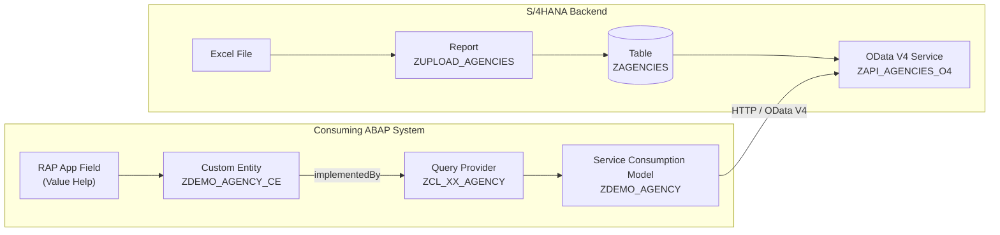
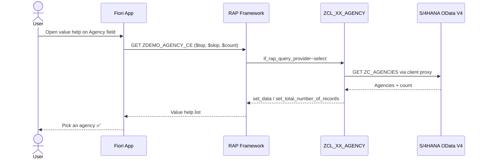

<div align="center">

# 🌐 Custom Entity with Remote OData Consumption — SAP RAP

### Read live data from S/4HANA through a Service Consumption Model and use it as a Value Help in RAP


</div>

---

## 📖 Overview

Not every RAP entity reads from a local database table. A **custom entity** lets you define the data model in CDS while the data itself comes from **ABAP code** — in this case, a **remote OData V4 service** on an S/4HANA system.

In this scenario:

1. A **travel agencies table** (`ZAGENCIES`) on the S/4HANA backend is filled with sample data using an upload report.
2. The table is exposed as an **OData V4 service** (`ZAPI_AGENCIES_O4`).
3. On the consuming ABAP system (e.g. SAP BTP ABAP Environment), a **Service Consumption Model** (`ZDEMO_AGENCY`) generates the client proxy.
4. A **custom entity** (`ZDEMO_AGENCY_CE`) with a **query provider class** (`ZCL_XX_AGENCY`) calls the remote service at runtime.
5. The custom entity is used as a **value help** in a RAP app — live remote data, no replication.

---

## 🏗️ Architecture



---

## 📦 Object Inventory

| # | Object | Type | System | Purpose |
|---|--------|------|--------|---------|
| 1 | `ZAGENCIES` | Database Table | S/4HANA | Travel agency master data |
| 2 | `ZUPLOAD_AGENCIES` | Executable Report | S/4HANA | Upload sample data from Excel |
| 3 | `ZAPI_AGENCIES_O4` | OData V4 Service | S/4HANA | Exposes agencies (entity set `ZC_AGENCIES`) |
| 4 | `ZDEMO_AGENCY` | Service Consumption Model | Consumer | Generated OData client proxy |
| 5 | `ZDEMO_AGENCY_CE` | Custom Entity | Consumer | CDS model for remote data |
| 6 | `ZCL_XX_AGENCY` | ABAP Class | Consumer | `IF_RAP_QUERY_PROVIDER` implementation |
| 7 | — | CDS Annotation | Consumer | Value help on a RAP field |

---

## ✅ Prerequisites

- An S/4HANA system reachable over HTTP(S) from the consuming system
- ADT (Eclipse) with access to both systems
- On BTP: a communication arrangement / destination for the backend (recommended for production)
- The `$metadata` (EDMX) file of the backend OData V4 service

---

## 🛠️ Step-by-Step Implementation

### Step 1: Database Table `ZAGENCIES` (S/4HANA)

```abap
@EndUserText.label : 'z travel agencies'
@AbapCatalog.enhancement.category : #NOT_EXTENSIBLE
@AbapCatalog.tableCategory : #TRANSPARENT
@AbapCatalog.deliveryClass : #A
@AbapCatalog.dataMaintenance : #RESTRICTED
define table zagencies {

  key client    : abap.clnt not null;
  key agency_id : abap.char(10) not null;
  name          : abap.char(100);
  street        : abap.char(60);
  postal_code   : abap.char(10);
  city          : abap.char(40);
  country       : abap.char(40);
  phone_number  : abap.char(20);
  web_address   : abap.char(255);
  created_at    : abap.utclong;
  created_by    : abap.char(12);
  changed_at    : abap.utclong;
  changed_by    : abap.char(12);

}
```

---

### Step 2: Upload Report `ZUPLOAD_AGENCIES` (S/4HANA)

> 📌 Use an XLS file **without a header row**, and make sure the **first column is the client** field.

```abap
*&---------------------------------------------------------------------*
*& Report zupload_agencies
*&---------------------------------------------------------------------*
*&
*&---------------------------------------------------------------------*
REPORT zupload_agencies.

"""Use XLS files without header and make sure first field is client field


data : it_text type truxs_t_text_data.
data :    lt_upload  type STANDARD TABLE OF zagencies with DEFAULT KEY.

parameters : p_file type rlgrap-filename.

at selection-screen on value-request for p_file.

CALL FUNCTION 'F4_FILENAME'
 EXPORTING
   FIELD_NAME          = 'p_file'
 IMPORTING
   FILE_NAME           = p_file
          .

START-Of-SELECTION.

CALL FUNCTION 'TEXT_CONVERT_XLS_TO_SAP'
  EXPORTING
    i_tab_raw_data             = it_text
    i_filename                 = p_file
  TABLES
    i_tab_converted_data       = lt_upload
 EXCEPTIONS
   CONVERSION_FAILED          = 1
   OTHERS                     = 2
          .
IF sy-subrc <> 0.
  write : / 'Uploading Failed'.
ENDIF.

*SELECT * FROM ZAS_ELECTION INTO CORRESPONDING FIELDS OF TABLE lt_upload.

*DELETE FROM ZAS_ELECTION.
*LOOP AT lt_upload ASSIGNING FIELD-SYMBOL(<fs>).
*  <fs>-keys = sy-tabix.
*  <fs>-currency = 'INR'.
*ENDLOOP.
DELETE from zagencies.

insert zagencies from table lt_upload.
*Delete from ZAS_ELECTION where Positions <> 1.
```

> ⚠️ The report runs `DELETE FROM zagencies` before inserting — every run **replaces** all existing data.

---

### Step 3: Expose the Table as an OData V4 Service (S/4HANA)

Create a projection view `ZC_AGENCIES` on `ZAGENCIES`, a service definition, and a service binding of type **OData V4 – Web API** named `ZAPI_AGENCIES_O4`. Publish it and note the service URL:

```
/sap/opu/odata4/sap/zapi_agencies_o4/srvd_a2x/sap/zapi_agencies_o4/0001/
```

Download the service `$metadata` — you'll need it in the next step.

---

### Step 4: Create the Service Consumption Model (Consumer)

In ADT on the consuming system: **New → Other ABAP Repository Object → Service Consumption Model**

| Setting | Value |
|---|---|
| Name | `ZDEMO_AGENCY` |
| Remote Consumption Mode | OData |
| Service Metadata File | the downloaded `$metadata` EDMX |

This generates the proxy class with the type `zdemo_agency=>tys_zc_agenciestype` used in the query provider.

---

### Step 5: Custom Entity `ZDEMO_AGENCY_CE`

```abap
@EndUserText.label: 'Custom Entity Agency'
@ObjectModel.query.implementedBy: 'ABAP:ZCL_XX_AGENCY'
define custom entity ZDEMO_AGENCY_CE
{
  key Agency_Id : abap.char( 6 );
  Name : abap.char( 31 );
  Street: abap.char( 30 );
  PostalCode: abap.char( 10 );
  City: abap.char( 25 );
  Country: abap.char( 3 );
  PhoneNumber: abap.char( 30 );
  WebAddress: abap.char( 255 );
  
}
```

The annotation `@ObjectModel.query.implementedBy` tells the RAP framework which class supplies the data at runtime.

---

### Step 6: Query Provider Class `ZCL_XX_AGENCY`

**What it does:**
1. Reads paging, requested fields and sort order from the incoming RAP request
2. Creates an HTTP client to the backend
3. Builds an OData V4 remote client proxy from the service consumption model
4. Reads the `ZC_AGENCIES` entity set and returns the result (plus total count) to RAP

```abap
CLASS zcl_xx_agency DEFINITION
  PUBLIC
  FINAL
  CREATE PUBLIC .

  PUBLIC SECTION.

    INTERFACES if_rap_query_provider .
  PROTECTED SECTION.
  PRIVATE SECTION.
ENDCLASS.


CLASS zcl_xx_agency IMPLEMENTATION.


  METHOD if_rap_query_provider~select.


    DATA:
      lt_business_data TYPE TABLE OF zdemo_agency=>tys_zc_agenciestype,
      lo_http_client   TYPE REF TO if_web_http_client,
      lo_client_proxy  TYPE REF TO /iwbep/if_cp_client_proxy,
      lo_request       TYPE REF TO /iwbep/if_cp_request_read_list,
      lo_response      TYPE REF TO /iwbep/if_cp_response_read_lst.

        DATA(top)     = io_request->get_paging( )->get_page_size( ).
        DATA(skip)    = io_request->get_paging( )->get_offset( ).
        DATA(requested_fields)  = io_request->get_requested_elements( ).
        DATA(sort_order)    = io_request->get_sort_elements( ).


         TRY.
         " Create http client
*         DATA(lv_http_destination) = cl_http_destination_provider=>create_by_cloud_destination(
*                                       i_name                  = 'S4HANA2'
*                                       i_service_instance_name = 'mydest'
*                                       i_authn_mode            = if_a4c_cp_service=>service_specific
*                                     )
*                                     .
         DATA(lv_http_destination) = cl_http_destination_provider=>create_by_url( i_url = 'http://<YOUR_HOST>:<PORT>' ).


         lo_http_client = cl_web_http_client_manager=>create_by_http_destination( i_destination = lv_http_destination ).
	
	 ""Non Productive BTP Accounts, we need to pass hardcoceed auth data
         lo_http_client->get_http_request( )->set_header_field(
                          i_name  = 'Authorization'
                          i_value = |Basic BASE64_USER:PASS| ).

         lo_client_proxy = /iwbep/cl_cp_factory_remote=>create_v4_remote_proxy(
                             is_proxy_model_key       = VALUE #( repository_id       = 'DEFAULT'
                                                                  proxy_model_id      = 'ZDEMO_AGENCY'
                                                                  proxy_model_version = '0001' )
                             io_http_client           = lo_http_client
                             iv_relative_service_root = '/sap/opu/odata4/sap/zapi_agencies_o4/srvd_a2x/sap/zapi_agencies_o4/0001/'
*                             iv_do_fetch_csrf_token   = abap_true
                           ).

         ASSERT lo_http_client IS BOUND.


    " Navigate to the resource and create a request for the read operation
    lo_request = lo_client_proxy->create_resource_for_entity_set( 'ZC_AGENCIES' )->create_request_for_read( ).

      IF io_request->is_data_requested( ) = abap_true.
        lo_request->set_skip( CONV i( skip ) ).
        IF top > 0 .
          lo_request->set_top( CONV i( top ) ).
        ENDIF.
      ENDIF.

      IF io_request->is_total_numb_of_rec_requested(  ) = abap_true.
        lo_request->request_count(  ).
      ENDIF.

    lo_request->set_top( 50 )->set_skip( 0 ).

    " Execute the request and retrieve the business data
    lo_response = lo_request->execute( ).
    lo_response->get_business_data( IMPORTING et_business_data = lt_business_data ).

    IF io_request->is_total_numb_of_rec_requested(  ).
      io_response->set_total_number_of_records(  lo_response->get_count(  ) ).
    ENDIF.

    IF io_request->is_data_requested(  ).
      io_response->set_data( lt_business_data ).
    ENDIF.

      CATCH cx_http_dest_provider_error INTO DATA(lx_dest_error).
    " ❌ Destination error - most likely issue
    data(ldls) = lx_dest_error->get_longtext( )..
    RAISE EXCEPTION lx_dest_error.

  CATCH /iwbep/cx_cp_remote INTO DATA(lx_remote).
    " ❌ Remote OData service error
    data(lv1) = lx_remote->get_longtext( ).

  CATCH /iwbep/cx_gateway INTO DATA(lx_gateway).
    " ❌ Gateway error
    data(lv2) = lx_remote->get_longtext( ).

  CATCH cx_web_http_client_error INTO DATA(lx_http_error).
    " ❌ HTTP client error
    data(lv23) = lx_remote->get_longtext( ).

    RAISE EXCEPTION lx_http_error.

  CATCH cx_root INTO data(lx_exception).
    " ❌ Unexpected error
    data(lv4) = lx_exception->get_longtext( ).

  ENDTRY.


  ENDMETHOD.
ENDCLASS.
```

> 🔐 **Destination options:** The commented-out `create_by_cloud_destination` call is the recommended approach on BTP (credentials stay in the destination service). The `create_by_url` + hard-coded `Authorization` header shown here is a shortcut for trial / non-productive accounts only.

---

### Step 7: Use the Custom Entity as a Value Help

Add this annotation to the field in your RAP projection view or metadata extension:

```abap
    @Consumption.valueHelpDefinition: [{ 
        entity:{
            name: 'ZDEMO_AGENCY_CE',
            element: 'AgencyId'
        }        
     }]
```

Remember to also **expose `ZDEMO_AGENCY_CE` in your service definition** so the value help is available in the OData service.

---

## 🎬 Runtime Flow



---

## ⚠️ Notes Before You Build

A few things in the code are worth fixing or explaining to viewers:

- **Value help element name:** The custom entity field is `Agency_Id`, but the value help annotation points to `AgencyId`. These must match exactly.
- **Paging is overridden:** `lo_request->set_top( 50 )->set_skip( 0 ).` runs *after* the paging logic, so the UI's `$top`/`$skip` are ignored and only the first 50 records are ever returned. Remove that line to honour the requested page.
- **Wrong exception variable:** In the `/iwbep/cx_gateway` and `cx_web_http_client_error` handlers, `lx_remote` is used instead of `lx_gateway` / `lx_http_error`. Since `lx_remote` is unbound there, this would cause a runtime dump.
- **Syntax:** `get_longtext( )..` has a double period.
- **Errors are swallowed:** The `/iwbep/cx_cp_remote`, gateway and `cx_root` handlers only read the long text. Consider raising a RAP query exception so the UI shows a meaningful error.
- **Unused variables:** `requested_fields` and `sort_order` are read but not passed to the remote request — a natural next step is to map them to `set_select_properties` and `set_orderby`.
- **Field lengths differ:** The custom entity uses shorter lengths than `ZAGENCIES` (e.g. `Agency_Id` 6 vs 10, `Name` 31 vs 100). Keep them consistent with the remote service to avoid truncation.
- **Credentials:** Never commit real hosts, IPs or Base64 credentials to GitHub. The URL above has been replaced with `<YOUR_HOST>:<PORT>`.

---

## 🤝 Contributing

Found an improvement or a better approach? Pull requests and issues are welcome!

## ⭐ Support

If this helped you, give the repo a ⭐ and subscribe to the YouTube channel for more SAP RAP, ABAP Cloud and BTP tutorials!

<div align="center">

**Happy Coding! 🚀**

</div>
